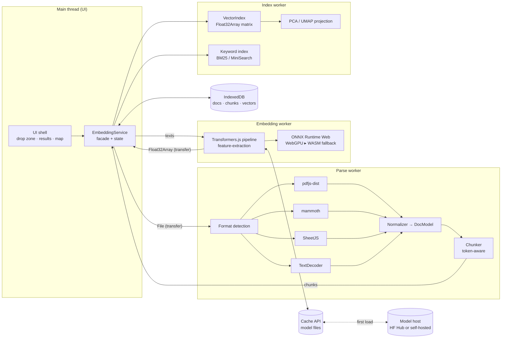

# Browser-Side Document Embeddings — Architecture

**Status:** Draft / proposal
**Scope:** A demo app that takes a Word, Excel, PDF, or text file, parses it, chunks it, generates text embeddings, and supports semantic search and visualization. All of it runs **entirely in the browser** using Transformers.js (v4.x, currently 4.3.2).

---

## 1. Goals and non-goals

### Goals
- **Zero backend.** No document content leaves the device. Parsing, embedding, indexing and search all run client-side.
- **Multi-format ingestion:** `.docx`, `.xlsx` / `.xls` / `.csv`, `.pdf`, `.txt` / `.md`.
- **Provenance.** Every chunk traces back to its file, page, sheet/row range, or heading path.
- **Interactive exploration:** semantic search, a chunk inspector, a 2D embedding map, and a model comparison.
- **Responsive UI.** All heavy work (parsing, inference, search) runs off the main thread.
- **Portable output.** Export chunks and vectors in a shape a server-side index can ingest, using the same model so query vectors are compatible.

### Non-goals (for the demo)
- OCR of scanned PDFs (noted as an extension point).
- Multi-user / shared indexes.
- Corpora beyond roughly 100k chunks. Brute-force search is intentional at this scale.

---

## 2. High-level architecture



Three dedicated workers keep the concerns isolated:

| Worker | Why separate |
|---|---|
| **Parse** | Untrusted input. Parsers are CPU-heavy and can hang or blow up on malformed files, so this worker can be killed and restarted without losing the model. |
| **Embedding** | Owns the model and GPU context. It is long-lived because model load is expensive. |
| **Index** | Search and projection math stay off the main thread, and the vector matrix lives next to the code that scans it. |

For the smallest possible demo, Parse and Index can collapse into a single worker. Keep the embedding worker separate regardless.

---

## 3. Pipeline stages

### 3.1 Ingestion and format detection
- Accept files via drag-and-drop or `<input type="file" multiple>`.
- Detect the format by **magic bytes first, extension second**. `.docx` and `.xlsx` are both ZIPs (`PK\x03\x04`), so tell them apart by peeking at `[Content_Types].xml` or by trusting the extension after the ZIP check. PDF starts with `%PDF`.
- Hash each file with `crypto.subtle.digest('SHA-256', buf)`. That gives the `docId` and the cache key. Re-dropping the same file skips straight to the stored vectors.
- Guard rails: a max file size (e.g. 50 MB), a max decompressed size for ZIP-based formats (zip-bomb protection), and a parse timeout enforced by the main thread terminating the worker.

### 3.2 Parsing (format adapters)

Each adapter turns its format into the common **DocModel** (§4). Structure is preserved where the format offers it, because structure drives good chunking.

| Format | Library | Strategy | Structure retained |
|---|---|---|---|
| PDF | `pdfjs-dist` (worker build) | `page.getTextContent()` per page. Rebuild lines by grouping text items on Y (`transform[5]`) and sorting by X. Detect paragraph breaks from vertical gaps. Strip running headers and footers that repeat across pages. | Page numbers; approximate paragraphs |
| DOCX | `mammoth` | `convertToHtml()` (not `extractRawText`), then walk the HTML. `h1`–`h6` become sections; `p`, `li` and `table` become blocks. | Heading hierarchy, lists, tables |
| XLSX / XLS / CSV | SheetJS (`xlsx`) | Per sheet: detect the header row and serialize each row as `Header: value; Header: value`. Skip empty rows and columns. Note: get the current SheetJS build from `cdn.sheetjs.com`; the npm `xlsx` package is stale. | Sheet name, header names, row ranges |
| TXT / MD | `TextDecoder` (UTF-8, BOM-aware) | For Markdown, split on `#` headings. For plain text, split on blank lines. | Headings (MD), paragraphs |

**Extension point:** if a PDF page yields no text but has image content, flag it as `needsOcr`. A later phase can run `tesseract.js` on those pages.

### 3.3 Chunking

Chunk size has to respect the **model's token limit**, not a character count. Use the model's own tokenizer (`AutoTokenizer` from the model repo, or the standalone `@huggingface/tokenizers` package) to measure.

**Algorithm: structure-first recursive split**
1. Start from the DocModel's structural units: sections, pages, or row groups.
2. If a unit fits within `maxTokens`, emit it as one chunk.
3. Otherwise split recursively on progressively finer boundaries: paragraph → sentence → word.
4. Merge adjacent small pieces until the chunk nears `targetTokens`.
5. Apply an overlap of about 10–15% of `targetTokens` between consecutive chunks within the same section, never across sections.

**Contextual chunk header.** Prepend a short breadcrumb to the text that gets embedded (not to the text that gets displayed):

```
[q3-sales.xlsx › Sheet "Sales" › rows 8–13]
Region: West; Month: September; Rep: Theo; Revenue: 88,000; Deals: 7; ...
```

This consistently improves retrieval for chunks whose meaning depends on where they sit, such as spreadsheet rows or sub-sections.

**Spreadsheet specifics.** Group N rows per chunk (N chosen by token budget) and repeat the header context in every chunk. For wide sheets, consider one chunk per row.

**Defaults** (tunable in the UI for the demo):

| Model max | `targetTokens` | `maxTokens` | overlap |
|---|---|---|---|
| 256 | 200 | 256 | 32 |
| 512 | 384 | 512 | 48 |
| 2048 | 512 | 1024 | 64 |

(Bigger isn't automatically better. Retrieval precision usually drops once chunks span several topics.)

### 3.4 Embedding

Runs in the **embedding worker**, using a singleton `feature-extraction` pipeline.

```ts
const extractor = await pipeline('feature-extraction', profile.modelId, {
  device: hasWebGPU ? 'webgpu' : 'wasm',
  dtype: hasWebGPU ? 'fp16' : 'q8',
  progress_callback: (p) => postMessage({ type: 'progress', ...p }),
});

const out = await extractor(batch, { pooling: profile.pooling, normalize: true });
// out.data is a Float32Array of length batch.length * dims
```

Key design points:
- **Model profiles.** Models differ in prefixes, pooling and dimensions, so wrap each one in a `ModelProfile` (§5) and never hard-code those details.
- **Query vs. passage asymmetry.** E5, BGE, Nomic and EmbeddingGemma expect different prefixes for queries and for documents. Getting this wrong quietly degrades quality, so the profile owns it.
- **Batching.** Sort chunks by token length before batching to minimize padding waste, then restore the original order. Start with a batch size of 16–32 on WebGPU and 4–8 on WASM, and adapt based on measured latency.
- **Transfer, don't copy.** Post results back with the `Float32Array` buffer in the transfer list.
- **Cancellation.** Check a `cancelled` flag between batches. Calls that are already in flight can't be interrupted.
- **Device detection.** `navigator.gpu?.requestAdapter()` decides WebGPU vs. WASM. Show the device actually in use in the UI, since it matters a lot for perceived performance.

### 3.5 Indexing and search

**VectorIndex** (index worker):
- One growable `Float32Array` holding `n × dims` row-major values, plus a parallel `chunkIds: string[]`.
- Vectors are L2-normalized at embed time, so **cosine similarity = dot product**.
- Search is a brute-force scan with a size-k min-heap. At 384 dims, 100k chunks is about 38M multiply-adds per query, which takes milliseconds.
- Memory is 4 bytes × dims per chunk: 384d × 100k ≈ 154 MB. To go further, store int8-quantized vectors (4× smaller), or binary vectors with float rescoring of the top 100.

**Hybrid search (recommended, even for a demo):**
- A keyword index (`MiniSearch`, or a small BM25 implementation) runs over the same chunks.
- Fuse the two rankings with **Reciprocal Rank Fusion**: `score = Σ 1 / (60 + rank_i)`.
- Show semantic, keyword and hybrid side by side. It's the most instructive thing the demo can show.

**Optional reranking:** run a cross-encoder (e.g. an MS MARCO MiniLM cross-encoder in ONNX form) over the top 20–50 hybrid results. It costs one more model download but makes a clear quality difference.

### 3.6 Visualization
- **2D map:** PCA (deterministic, fast, few lines of code) by default, with UMAP (`umap-js`) as an option.
  - PCA can project the **query vector** into the same space, so a query pin can be shown among the chunks. UMAP doesn't support that cleanly.
- Render on a `<canvas>`, not SVG, so a few thousand points stay smooth. Color by source file, size by match score, and show the chunk text and provenance on hover.
- **Similarity heatmap** (chunk × chunk, for one document) is useful for spotting near-duplicates and topic structure.

### 3.7 Persistence
IndexedDB, keyed so that changing anything that affects vectors invalidates them:

```
cacheKey = sha256(file) + ':' + modelId + ':' + dtype + ':' + chunkerVersion
```

| Store | Key | Value |
|---|---|---|
| `documents` | `docId` | file name, size, type, parsed DocModel summary, timestamps |
| `chunks` | `chunkId` | text, embedText, provenance, `docId`, `cacheKey` |
| `vectors` | `cacheKey` | `{ dims, count, buffer: ArrayBuffer, chunkIds[] }` |

Model weights are cached separately by Transformers.js through the Cache API (`env.useBrowserCache`), with optional WASM caching (`env.useWasmCache`) for offline use.

---

## 4. Common document model

```ts
interface DocModel {
  docId: string;                 // sha256 of bytes
  fileName: string;
  format: 'pdf' | 'docx' | 'xlsx' | 'csv' | 'txt' | 'md';
  blocks: Block[];               // reading order
  warnings: string[];            // e.g. "page 4 has no extractable text"
}

type Block =
  | { kind: 'heading'; level: number; text: string; loc: Loc }
  | { kind: 'paragraph'; text: string; loc: Loc }
  | { kind: 'listItem'; text: string; depth: number; loc: Loc }
  | { kind: 'table'; headers: string[]; rows: string[][]; loc: Loc }
  | { kind: 'record'; sheet: string; row: number; fields: Record<string, string>; loc: Loc };

interface Loc {
  page?: number;                 // PDF
  sheet?: string; rowStart?: number; rowEnd?: number;   // spreadsheets
  headingPath?: string[];        // DOCX / MD
  charStart?: number; charEnd?: number;
}

interface Chunk {
  chunkId: string;               // `${docId}:${ordinal}`
  docId: string;
  ordinal: number;
  text: string;                  // what the user sees
  embedText: string;             // header + text (+ passage prefix applied later)
  tokenCount: number;
  loc: Loc;                      // merged provenance
}
```

Chunkers depend only on `DocModel` and never on a parser, so adding a format means writing one adapter.

---

## 5. Model profiles

```ts
interface ModelProfile {
  id: string;                    // HF repo id (ONNX-converted)
  label: string;
  dims: number;
  maxTokens: number;
  pooling: 'mean' | 'cls';
  queryPrefix: string;
  passagePrefix: string;
  matryoshkaDims?: number[];     // truncatable dims, if supported
  multilingual: boolean;
}
```

Candidate models to offer in a model switcher:

| Model | Dims | Max tokens | Pooling | Prefixes | Notes |
|---|---|---|---|---|---|
| `Xenova/all-MiniLM-L6-v2` | 384 | 256 | mean | none | ~23M params; tiny, fast. The "hello world" baseline. |
| `Xenova/bge-small-en-v1.5` | 384 | 512 | cls | query: `Represent this sentence for searching relevant passages: ` | Noticeably better retrieval at a similar size. |
| `Xenova/multilingual-e5-small` | 384 | 512 | mean | `query: ` / `passage: ` | Spanish + English and ~100 languages. |
| `nomic-ai/nomic-embed-text-v1.5` | 768 (MRL) | 2048 | mean | `search_query: ` / `search_document: ` | Long context; Matryoshka truncation to 512/256/128. |
| `onnx-community/embeddinggemma-300m-ONNX` | 768 (MRL) | 2048 | mean | task-style prefixes per model card | Strongest of the set and multilingual, but a much larger download. |

Check each model card for the exact prefix strings before shipping. They're the most common source of "why is retrieval bad?"

For a demo, a **side-by-side model comparison** (same query, same chunks, two models) is a compelling feature: it makes the trade-off between size, speed and quality concrete.

---

## 6. Worker message contracts

```ts
// ---- Embedding worker ----
type EmbedIn =
  | { type: 'init'; profile: ModelProfile; device: 'webgpu' | 'wasm'; dtype: string }
  | { type: 'embed'; requestId: string; texts: string[]; kind: 'query' | 'passage' }
  | { type: 'cancel'; requestId: string };

type EmbedOut =
  | { type: 'loadProgress'; file: string; loaded: number; total: number }
  | { type: 'ready'; device: 'webgpu' | 'wasm'; dims: number; loadMs: number }
  | { type: 'batchProgress'; requestId: string; done: number; total: number }
  | { type: 'embedded'; requestId: string; vectors: Float32Array; dims: number; ms: number }
  | { type: 'error'; requestId?: string; message: string };

// ---- Parse worker ----
type ParseIn  = { type: 'parse'; jobId: string; file: File; chunking: ChunkingOptions };
type ParseOut =
  | { type: 'parsed'; jobId: string; doc: DocModel; chunks: Chunk[] }
  | { type: 'error'; jobId: string; message: string };

// ---- Index worker ----
type IndexIn =
  | { type: 'add'; chunkIds: string[]; vectors: Float32Array; dims: number }
  | { type: 'search'; queryId: string; vector: Float32Array; k: number; mode: 'semantic' | 'keyword' | 'hybrid'; queryText: string }
  | { type: 'project'; method: 'pca' | 'umap' }
  | { type: 'clear' };
```

A thin `EmbeddingService` on the main thread wraps these as promises/observables (RxJS or signals in Angular), correlating by `requestId`.

---

## 7. UI surface (demo)

1. **Drop zone** with per-file status: *parsing → chunking → embedding n/N → indexed*.
2. **Model panel:** model picker, device badge (WebGPU/WASM), dtype, first-load download progress, load time.
3. **Document inspector:** parsed blocks, then the chunks with token counts and provenance. Chunk boundaries are highlighted, and chunking parameters can be changed live (which re-chunks and re-embeds).
4. **Search:** query box; result list with score, source file, page/sheet/heading, and the matched chunk; a semantic / keyword / hybrid toggle.
5. **Embedding map:** 2D scatter colored by file, with a query pin and the top-k highlighted.
6. **Metrics strip:** chunks, dims, embed throughput (chunks/sec), index memory, query latency.
7. **Export:** JSON or JSONL of `{ chunkId, docId, text, loc, vector }`, plus a manifest recording `modelId`, `dtype`, `dims`, `chunkerVersion` and prefixes, so a server-side index can be built from it and queried with the same model.

---

## 8. Deployment and hosting

**Static hosting** (Azure Static Web Apps, S3 + CloudFront, GitHub Pages, etc.). Nothing runs server-side.

**Model and runtime delivery — choose one:**

| Option | How | Trade-off |
|---|---|---|
| Hub at runtime (default) | Transformers.js fetches from `huggingface.co`, then caches | Simplest; depends on the Hub and outbound access. |
| Self-hosted | `env.allowRemoteModels = false; env.localModelPath = '/models/'`; copy the ONNX + tokenizer files into the static site | Works on locked-down networks, versioned with the app, no third-party dependency at runtime. |
| Self-hosted runtime | Serve the ONNX Runtime `.wasm` yourself (`env.backends.onnx.wasm.wasmPaths`) | Needed if a CDN is blocked. The ORT WASM binaries are ~14–28 MB depending on variant (plain / JSEP-WebGPU / asyncify). |

**Headers and CSP:**
- `script-src` must allow wherever the transformers bundle and ORT loader come from, plus `'wasm-unsafe-eval'` for WASM compilation.
- `connect-src` must allow the model host and any CDN the runtime fetches `.wasm` from. On the Hub, that includes its file-storage redirect targets.
- `worker-src 'self' blob:`.
- **Multithreaded WASM** needs `SharedArrayBuffer`, which needs cross-origin isolation: `Cross-Origin-Opener-Policy: same-origin` plus `Cross-Origin-Embedder-Policy: credentialless` (or `require-corp`, if every cross-origin asset sends CORP headers). Without isolation, ORT falls back to single-threaded WASM, which is correct but slower. WebGPU doesn't need isolation.

**Payload budget (first visit), smallest configuration:**
- Transformers.js web build: ~0.45 MB minified
- ORT WASM: ~14–28 MB (one variant is downloaded, based on device)
- Model: ~23 MB (MiniLM q8) up to several hundred MB (EmbeddingGemma)
- Parsers: pdf.js ~1–2 MB (+ worker), mammoth ~0.6 MB, SheetJS ~1 MB. **Lazy-load each parser on first use of its format.**

---

## 9. Performance notes
- **First-load experience dominates perception.** Show real download progress, and say plainly that later visits are instant because the files are cached.
- **Warm up the model** with a dummy one-token embed after load, so the first real query doesn't pay shader/graph compilation cost.
- **Sort-by-length batching** typically cuts embedding time noticeably on mixed-length chunks.
- **Embed incrementally:** stream batches into the index as they finish, so search works before the whole file is done.
- **Don't re-embed for a re-search.** Only queries are embedded at search time; passages are embedded once per `cacheKey`.
- **WebGPU fp16 vs WASM q8:** quantized weights shrink downloads and help on CPU. On GPU, fp16 is usually the better speed/quality point. Make it a profile setting, not a constant.

---

## 10. Security and privacy
- Files are read with `File.arrayBuffer()` and never uploaded. Say so in the UI, since it's the headline benefit.
- Treat every file as hostile: parse in a killable worker, enforce size and time limits, and never inject parsed HTML (from mammoth) into the live DOM. Walk it in a `DOMParser` document or a sandboxed structure and extract text only.
- Pin library versions and use Subresource Integrity (`integrity=`) on any CDN-loaded scripts.
- If models load from the Hub, the only outbound requests are model-file GETs. Document that for security review.

---

## 11. Suggested project structure

```
src/
  app/                         # UI shell (Angular or vanilla TS)
    components/ dropzone, model-panel, inspector, search, map, metrics
    services/
      embedding.service.ts     # worker facade, request correlation
      store.service.ts         # IndexedDB access (idb)
  workers/
    parse.worker.ts
    embed.worker.ts
    index.worker.ts
  ingest/
    detect.ts
    adapters/ pdf.ts docx.ts xlsx.ts text.ts
    docmodel.ts
  chunking/
    chunker.ts                 # structure-first recursive splitter
    tokenizer.ts               # token counting via model tokenizer
  models/
    profiles.ts                # ModelProfile registry
  search/
    vector-index.ts            # Float32Array matrix + heap top-k
    keyword-index.ts           # MiniSearch / BM25
    fusion.ts                  # RRF
    projection.ts              # PCA / UMAP
public/
  models/                      # (optional) self-hosted ONNX + tokenizer files
  ort/                         # (optional) self-hosted ORT wasm
```

In Angular, `ng generate web-worker` gives the worker build wiring. Expose progress and state as signals, so the components can bind to *loading / embedding n/N / ready* directly.

---

## 12. Phased plan

| Phase | Deliverable |
|---|---|
| **1 — MVP** | TXT + PDF + DOCX + XLSX parsing → fixed token chunking → MiniLM on WASM/WebGPU → in-memory brute-force search → results with provenance. |
| **2 — Quality** | Structure-aware chunking with contextual headers, model profiles with correct prefixes, hybrid search with RRF, IndexedDB persistence by `cacheKey`. |
| **3 — Exploration** | PCA map with query pin, chunk inspector with live re-chunking, side-by-side model comparison, metrics strip. |
| **4 — Extensions** | Cross-encoder reranking, OCR for scanned PDFs, int8/binary vector quantization, JSONL export for server-side indexing, a small local LLM answering over the top-k (in-browser RAG). |

---

## 13. Open questions
1. **Target corpus size:** a handful of documents, or hundreds? That decides whether brute force is enough and whether to quantize vectors.
2. **Language mix:** English only, or Spanish/multilingual? That decides the default model.
3. **Hosting constraints:** can the deployed app reach `huggingface.co`, or must models be self-hosted?
4. **Framework:** standalone vanilla TS for a portable demo, or built in Angular to show how it would slot into a production app?
5. **Server parity:** should exported vectors be directly loadable into an existing server-side index? If so, lock the model, dtype and prefixes to match it.